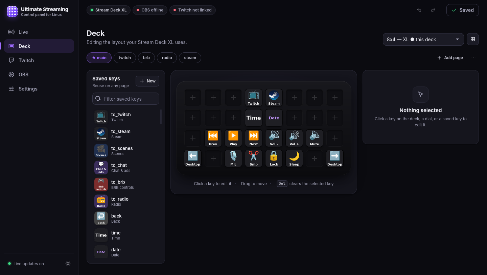
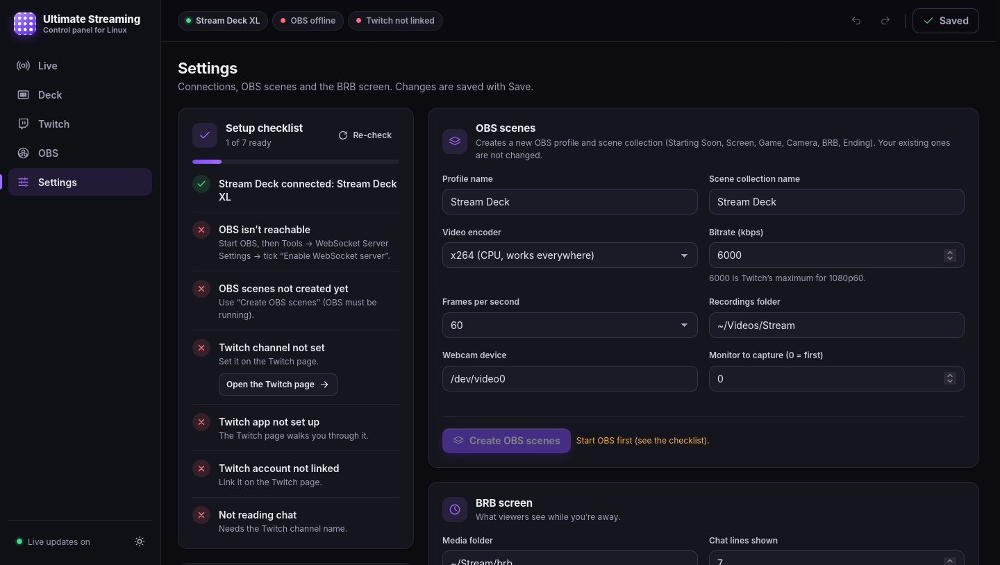
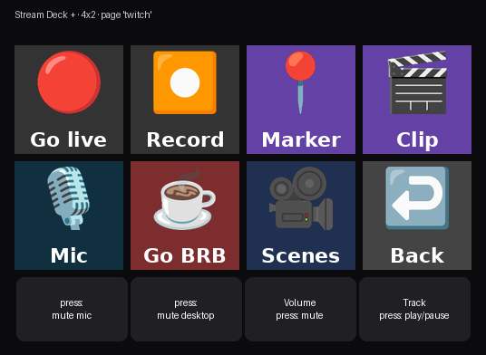

# The Ultimate Streaming Control Panel for Linux

Run OBS, Twitch and your desktop from any Elgato Stream Deck on Linux, or from a web
control panel in your browser. It comes with a ready-made OBS scene set (Starting Soon,
Screen, Game, Camera, an interactive BRB screen, Ending) for the deck to control.

- **Control panel:** go live, switch scenes, mix audio, read and moderate chat, link Twitch,
  and edit keys and pages with dropdowns of your OBS scenes, audio sources and Steam games.
  Everything is also one YAML file if you prefer editing by hand.
- **Every Stream Deck model**, several at once: Mini, Original / MK.2, Neo, XL, +, + XL,
  Studio, Pedal. Dials and touch strips work on the + models.
- **OBS:** streaming, recording, replay buffer, scene keys that follow your scene list,
  mute toggles, stream health and uptime on the keys.
- **Twitch:** clips, markers, ads, chat modes, viewer count, title/category/tags, and a chat
  bot with timers, commands and channel-point rewards.
- **BRB screen:** chat feed, viewer polls and a guessing game, a hype meter, your own videos
  with credits, and a "back in" timer.
- **Desktop:** media keys, volume and mic, apps, key combos and push-to-talk, Steam games
  with cover art, and Home Assistant.



| Settings view: the setup checklist | The same pages on a Stream Deck + (dials below) |
|---|---|
|  |  |

## Contents

1. [Prerequisites](#prerequisites)
2. [Install, update, uninstall](#install-update-uninstall)
3. [Coming from another setup](#coming-from-another-setup): backups, importing another deck app, keeping your OBS
4. [Set up OBS](#set-up-obs)
5. [Link Twitch](#link-twitch)
6. [BRB media](#brb-media)
7. [The control panel](#the-control-panel): views, backups, import, security
8. [Twitch Bot](#twitch-bot): timers, commands, rewards, chat stats
9. [Discord webhooks](#discord-webhooks): the Discord channels your features post to
10. [Go-live announcements](#go-live-announcements): post to Discord when you go live
11. [Twitch alerts](#twitch-alerts): follows, subs, cheers and raids on stream
12. [Configuring pages in YAML](#configuring-pages-in-yaml)
13. [Stream Deck models](#stream-deck-models), including several decks
14. [Optional integrations](#optional-integrations): Home Assistant, Steam, remote OBS
15. [Plugins](#plugins): installing optional integrations, including [Bambu Lab printers](#bambu-lab-printers)
16. [Files and settings reference](#files-and-settings-reference)
17. [Troubleshooting](#troubleshooting)
18. [Writing a module](#writing-a-module) (Python, only for new kinds of action)
19. [Writing a plugin](#writing-a-plugin)
20. [Development](#development): tests, CI, the panel's code, HTTP API, events

## Prerequisites

You need a Linux desktop with systemd (tested on X11) and **Python 3.14 or newer**. On an
older distro, get it with [pyenv](https://github.com/pyenv/pyenv): `pyenv install 3.14`, then
`pyenv local 3.14` in this folder. On Wayland, everything works except key-combo actions in
native Wayland windows.

Install the system packages for your distro. Only the first line is required; the others
add emoji, volume/mic keys (`pactl`, works with PipeWire), media keys (`dbus-send`),
notifications and links, key actions (libX11, libXtst) and the "Stream info" dialog (GTK 3).
`tools/doctor.py` reports anything missing.

```sh
# Debian / Ubuntu / Mint / Pop!_OS
sudo apt install python3 python3-pil python3-yaml python3-requests libhidapi-hidraw0 \
  fonts-dejavu-core fonts-noto-color-emoji fontconfig \
  pulseaudio-utils dbus libnotify-bin xdg-utils libx11-6 libxtst6 \
  python3-gi gir1.2-gtk-3.0

# Fedora
sudo dnf install python3 python3-pillow python3-pyyaml python3-requests hidapi \
  dejavu-sans-fonts google-noto-color-emoji-fonts fontconfig \
  pulseaudio-utils dbus-tools libnotify xdg-utils libX11 libXtst \
  python3-gobject gtk3

# Arch / Manjaro / EndeavourOS
sudo pacman -S python python-pillow python-yaml python-requests hidapi \
  ttf-dejavu noto-fonts-emoji fontconfig \
  libpulse dbus libnotify xdg-utils libx11 libxtst \
  python-gobject gtk3
```

You also need **OBS Studio 28 or newer** (distro package or the Flatpak
`com.obsproject.Studio`). For BRB videos, OBS needs its **VLC video source**: install VLC /
libvlc, or the Flatpak's VLC extension.

The Python libraries (`streamdeck`, `obsws-python`, `websocket-client`, `SQLAlchemy`,
`typing-extensions`) are downloaded by `install.sh` into `./vendor` and checked against the
hashes in `requirements.txt`, so you don't need pip or root. To use pip instead:
`python3 -m pip install --target vendor --require-hashes -r requirements.txt`.

### Device permissions

Your user must be able to open the Stream Deck (and `/dev/uinput` for key actions). Distros
with systemd 252 or newer usually allow this already. If yours doesn't, `install.sh` tells
you to install the included udev rule, which grants access to the logged-in desktop user:

```sh
sudo cp packaging/70-streamdeck.rules /etc/udev/rules.d/
sudo udevadm control --reload && sudo udevadm trigger     # then re-plug the deck
```

---

## Install, update, uninstall

Run these as your normal user, not root:

```sh
git clone https://github.com/zfouts/TheUltimateStreamingControlPanel.git
cd TheUltimateStreamingControlPanel/ultimate-streaming
./install.sh
```

`install.sh` fetches the Python libraries, creates `~/.config/ultimate-streaming/config.yaml`
from `config.example.yaml` (an existing one is kept), installs and starts the systemd user
service `ultimate-streaming`, adds **"The Ultimate Streaming Control Panel for Linux"** to
your applications menu, and runs `tools/doctor.py` to report anything missing. Settings from
an older version in `~/.config/streamdeck` are moved over, with a link left at the old path.

- **Without the service:** `./install.sh --no-service`, then start `python3 main.py` yourself.
- **To update:** `git pull && ./install.sh`. Your config is kept; compare it with
  `config.example.yaml` to find new features.
- **To uninstall:** `./install.sh --uninstall` removes the service and the menu entry, and lists
  where your data still is: config and tokens in `~/.config/ultimate-streaming`, backups (which
  include your OBS stream key) in `~/.local/state/ultimate-streaming`, and plugins in
  `~/.local/share/ultimate-streaming`. `./install.sh --purge` also deletes those folders, after
  you type `yes`.

---

## Coming from another setup

If you already use OBS or another Stream Deck program, the **Bring your existing setup**
assistant brings them over. It opens on its own the first time you open the panel on a fresh
install, if it finds an OBS profile besides "Untitled" or another deck program. Otherwise,
open it from **Settings → Existing setup → Open the setup assistant**. Its four steps are
**We found → Back up → Bring it over → Deck access**, and nothing changes until you choose to.

**We found** lists what it found in these places (**Scan again** looks again):

| Program | Where |
|---|---|
| OBS | `~/.config/obs-studio`, the Flatpak's `~/.var/app/com.obsproject.Studio/config/obs-studio`, and `$OBS_CONFIG_DIR` |
| StreamController (Flatpak) | `~/.var/app/com.core447.StreamController/data` |
| streamdeck-ui / streamdeck-linux-gui | `~/.streamdeck_ui.json` (or `$STREAMDECK_UI_CONFIG`) |
| Boatswain | its device files in `~/.local/share` and `~/.var/app/com.feaneron.Boatswain/data` |
| Elgato Stream Deck exports | `.streamDeckProfile` files in `~/Downloads`, `~/Documents` and `~/Desktop`, up to two folders deep |

### What is backed up

In the **Back up** step, check what to keep a copy of and press **Back up** (or **Skip**):
- **OBS:** every profile (including its stream key), every scene collection and the
  obs-websocket settings (including its password). OBS's browser-source data (logins,
  cookies, cache) is never included. With several OBS settings folders (native and Flatpak,
  say), each gets its own archive.
- **StreamController:** its data folder. **streamdeck-ui:** its config file.
  **Boatswain:** its device files. Elgato profile files aren't copied; they stay where they are.

The archives are saved in `~/.local/state/ultimate-streaming/backups/external/`. They contain
your stream key, so don't share them or copy them anywhere synced. They're kept out of
`~/.config` and out of the [daily backups](#backups-and-history).

- **Your first backup** is labelled "Before onboarding" and **pinned**: it's kept until you
  delete it.
- **Automatic backups:** OBS is backed up again before every change the panel or
  `obs/build_scenes.py` makes to it (unless nothing changed since the last one). A program's
  original autostart files are backed up, pinned, before the panel turns its autostart off.
- **Retention:** unpinned backups keep the newest 10 automatic, 10 manual and 10 pre-restore
  each. Past 3 GB in total, the oldest unpinned ones go, pre-restore backups last.
- A backup needs free disk space of twice its estimated size plus 1 GB.

### Restoring a backup

To restore, open **Settings → External backups** and press **Restore** next to the part you
want (OBS, or one program).
1. **Close OBS, or that program, first.** A restore refuses to run while it's open.
2. Confirm. The settings it replaces are backed up first (a pre-restore backup), so you can
   undo a restore by restoring that one. If a restore fails part-way, the previous files are
   put back.

OBS is restored into the OBS install you use: the running one, else the one whose settings
changed most recently. A program's files go back to its usual folder, even if you deleted
that folder. Files that aren't in the backup, such as a scene collection you created later,
are left alone. The same card has **Back up now**, **Pin** / **Unpin**, and delete (unpin first).
Autostart files are kept for reference and can't be restored there; see
[Stopping the other program](#stopping-the-other-program).

### Importing another deck app

In the **Bring it over** step, under **Keys and pages**, press **Preview** next to a program.
For an Elgato export that wasn't found, use **Import an Elgato profile (.streamDeckProfile)**
(50 MB at most). The preview works like [Import a setup](#importing-an-existing-setup): it
shows what will be added or replaced, and nothing of yours is overwritten unless you choose
the incoming version. Press **Import N changes** to save; a restore point is saved first.

You can import from **StreamController**, **streamdeck-ui**, **Boatswain** and **Elgato
`.streamDeckProfile`** exports (old and new formats, or a zip of several). Pages, folders (each
becomes a page, with a back key added where needed), labels, icons and colors come across.
So do actions that have an equivalent here: page switching, key combos, typed text, web
links, commands, OBS scene / mute / studio mode / stream / record toggles, media keys,
brightness and delays.
- **Page names** `back`, `pages` and `start_page` are reserved here; such pages get a suffix
  (`back_2`).
- **Several decks** merge into your layouts by key grid (`8x4`, `3x2`, …). A second deck with
  the same grid gets its own layout (`8x4-2`) and, when the source knows its serial, a
  `devices:` entry so that deck shows it. Otherwise, pick the layout in Settings → Decks.
- **Keys with several states** come in with one state: the first one (Elgato: the one saved
  in the profile).
- **Dials and touch screens** aren't imported.
- **Icons** must be PNG, JPEG, GIF or WebP. SVG and other formats are skipped, and those keys
  keep their label without an icon.
- **Guesses:** StreamController, streamdeck-ui and Boatswain don't store the deck model, and
  Elgato's format is undocumented, so some details are inferred. Every guess is listed as a
  warning in the preview; check them before you import.
- **Keys with no equivalent** (a Windows program path, an unsupported plugin) come in without
  an action, keeping their label and icon.

### Keeping your OBS scenes

If OBS already has a profile besides "Untitled", the deck **adopts** your current profile and
scene collection by default and doesn't create or change any scenes. In the **Bring it over**
step, under **OBS** (OBS must be running with its WebSocket server on):
- **What the deck controls:** **Keep using my current setup (recommended)**, or **Use another
  profile or scene collection** and press **Switch OBS to these**. OBS switches to it;
  nothing is created or deleted.
- **Add to a scene (optional):** choose a scene and press **Add** next to one item: stream
  title text, stream category text, starting-soon countdown text, radio music (`BRB Music`),
  or a color background for channel-point rewards (`Reward Background`, placed at the bottom
  of the scene). Nothing else in the scene changes. If a source with that name already exists
  but is a different kind, rename it in OBS first.

From a terminal, `python3 obs/build_scenes.py --adopt` adopts your current profile and
collection and creates the overlay text files. To get the starter scenes instead, see
[Set up OBS](#set-up-obs).

### Stopping the other program

A Stream Deck listens to only one program at a time. In the **Deck access** step, if
StreamController, streamdeck-ui or Boatswain is running, press **Stop *program* and turn off
its autostart** and confirm.
1. Its original autostart files are backed up into a pinned archive in External backups
   (the newest 5 per program stay pinned). If that backup fails, nothing is changed.
2. Its autostart is turned off. For each of its entries (`StreamController.desktop`,
   `com.core447.StreamController.desktop`, `streamdeck.desktop`,
   `com.feaneron.Boatswain.desktop`), a file with the same name containing `Hidden=true` is
   written to `~/.config/autostart/`. streamdeck-ui's `streamdeck.service` user unit is
   disabled if it was enabled.
3. The program is asked to quit. If it's still running after 5 seconds, **Force quit** ends
   it; anything it hasn't saved is lost.

To turn its autostart back on, delete the `Hidden=true` file from `~/.config/autostart/` and
turn autostart on again in the program. If that file replaced one of your own, the original
is in the pinned `…-before-stop-<program>.tar.gz` archive; extract it with, for example:
```sh
tar -xzOf ~/.local/state/ultimate-streaming/backups/external/<stamp>-before-stop-streamcontroller.tar.gz \
  streamcontroller/StreamController.desktop > ~/.config/autostart/StreamController.desktop
```
For streamdeck-ui, also run `systemctl --user enable streamdeck.service`.

### Reviewing imported keys

Imported keys that could do something unexpected **arrive switched off**, marked with an
amber **!** in the corner. Pressing one runs none of its actions and flashes it red. Only these
actions, with a simple argument, run straight away: `page`, `brightness`, `delay`, `notify`,
`obs_scene`, `obs_mute`, `obs_studio`, `media`, `volume` and `mic`. Everything else, including
commands, key combos, typed text and web links, waits for you.

After an import, **Waiting for your review** lists these keys; **Show in the Deck editor**
opens one. The key's **Imported action: off until you enable it** panel shows exactly what it
runs. Then:
- **Enable this action** turns that key on. Each key is enabled separately. If the key
  changed since you looked (another tab, a hand edit), it isn't enabled; check it again.
- **Remove it and pick another action** clears it so you can choose your own.

Keys that came in without an action show the same **!** and a **Pick an action** note. Choose
an action, then press **Done, hide this note**.

---

## Set up OBS

Open the control panel from your applications menu (or `python3 main.py --open-editor`) and
go to **Settings**. Its checklist covers these steps and has buttons for the ones that can
be automated. To do them by hand:

1. Start OBS, open **Tools → WebSocket Server Settings** and check **Enable WebSocket server**.
   The deck reads the port and password from OBS's settings.
2. Check the `obs_setup:` section of your config: resolution, fps, **encoder** (`x264` works
   everywhere, `nvenc` NVIDIA, `qsv` Intel, `amd` AMD), recordings folder, monitor, webcam.
3. With OBS running and not live, run `python3 obs/build_scenes.py`. What it does depends on
   `obs_setup.mode`:
   - **`adopt`**, the default if OBS already has a profile besides "Untitled": the deck uses
     your current profile and scene collection as they are. Only the overlay text files are
     created; nothing in OBS changes. To add the deck's sources to your own scenes, see
     [Keeping your OBS scenes](#keeping-your-obs-scenes). `--adopt` forces this mode for one run.
   - **`starter`**, the default on a fresh OBS: creates a profile and a scene collection, both
     named "Stream Deck", with the scenes below. It stops if that collection already exists.
     Your other profiles and collections are untouched; switch back from OBS's Profile / Scene
     Collection menus. To get the starter scenes on an OBS you already use, set
     `obs_setup: {mode: starter}`.

   OBS's files are [backed up](#what-is-backed-up) before any change. These options work in
   either mode, on the current collection:
   - To re-apply one starter scene's layout: `python3 obs/build_scenes.py --scene BRB`.
   - If OBS has no audio sources: `python3 obs/build_scenes.py --audio` (or **Add microphone &
     desktop audio** in the checklist). Without them the stream is silent and mute keys fail.
4. In OBS, **Settings → Stream**: connect your Twitch account or paste a stream key. In
   **Settings → Audio**, pick your mic and desktop audio. The deck's mute keys use OBS's
   default names, *Mic/Aux* and *Desktop Audio*.

On **Wayland**, OBS asks which screen or window to share when it creates the capture sources.

The starter scenes are listed below in dock order. The deck's `scene_slot` keys follow the
dock order of whichever collection you use, so reordering scenes in OBS reorders the keys.

| Scene | What's on it |
|---|---|
| Starting Soon | headline, countdown (the deck's *Start in 5:00*), stream title and category |
| Screen | full-screen capture + webcam corner |
| Game | window capture + webcam corner |
| Camera | full webcam, title lower third |
| BRB | "back in" timer, your videos, chat feed, polls / guess game, hype meter |
| Ending | thanks screen |

The on-screen title and category follow Twitch; the countdown, chat and polls follow the
deck. OBS reads them from text files in `~/.config/ultimate-streaming/overlay/`.

---

## Link Twitch

To link Twitch, open the control panel, go to **Twitch** (press `3`) and follow the steps:

1. **Channel.** Type your channel name and save.
2. **Twitch app.** At <https://dev.twitch.tv/console/apps>, choose **Register Your
   Application**. Name: anything; OAuth Redirect URLs: `http://localhost`; Category:
   Broadcaster Suite; **Client Type: Public**. Copy its **Client ID** into the panel and
   save. Public clients have no secret. Changing the Client ID later unlinks Twitch.
3. **Link your account.** Press **Link Twitch**, open the twitch.tv/activate link it shows,
   enter the code and approve before the countdown runs out. The panel picks it up itself.

The login is saved in `~/.config/ultimate-streaming/twitch.json` and refreshes itself.
**Unlink** revokes it at Twitch and deletes the file.

You can also put the values in your config, or set `TWITCH_CHANNEL` / `TWITCH_CLIENT_ID` in
`~/.config/ultimate-streaming/env`. The **Link Twitch** deck key (`twitch: login`) opens the
activation page in your browser.
```yaml
twitch:
  channel: yourchannel
  client_id: "your-client-id"
```

Twitch shows these scopes when you approve:

| Scope | What it enables |
|---|---|
| `clips:edit` | create clips |
| `channel:edit:commercial` | run ads (30 to 180 seconds) |
| `channel:manage:broadcast` | change title, category and tags; add stream markers |
| `moderator:manage:chat_settings` | chat modes: emote-only, followers-only, slow, subscribers-only, unique chat |
| `user:write:chat` | send chat messages from the panel and the Twitch Bot |
| `moderator:manage:chat_messages` | delete chat messages |
| `moderator:manage:banned_users` | time out and ban |
| `moderator:manage:announcements` | post announcements |
| `moderator:manage:shoutouts` | send shoutouts |
| `channel:manage:raids` | start and cancel raids |
| `channel:manage:redemptions` | the Twitch Bot: create and manage channel-point rewards, and refund failed redemptions |

If a new release needs a scope your login lacks (for example `channel:manage:redemptions`
if you linked before the Twitch Bot existed), the Twitch view lists it. Press **Link
Twitch** again and approve.

---

## BRB media

To show your own videos and play music on BRB (optional):

```
~/Stream/brb/videos/       videos for the BRB screen (played shuffled, one at a time, with their audio)
                           + credits.yaml:  "video.mp4": "Title by Author · CC BY 4.0"
~/Stream/radio/<Station>/  music folders for the radio (needs an OBS media source named "BRB Music")
```

Create these folders yourself (`mkdir -p ~/Stream/brb/videos ~/Stream/radio`); the app only
creates them when `brb.media_dir` or `radio.dir` is set. Only use videos and music you have the rights to stream. To use other folders, set
`brb.media_dir` and `radio.dir`.

On BRB, viewers can type `!1`–`!9` (poll votes), `!guess <minutes>` and `!hype`. Chat is read
anonymously; messages are posted only from the panel's chat box and announcements, and by
the [Twitch Bot](#twitch-bot) when it's on.

---

## The control panel

To open the panel, use the applications menu entry, run `python3 main.py --open-editor`, or
press a deck key with `action: {editor: open}`. It runs at `http://127.0.0.1:8765` and
updates live. `1`–`6` switch views when you're not typing in a field.

Each link carries a launch code that works once, within a minute, and only for the browser of
the user running the daemon; the page trades it for the panel's access token, which never
appears in a URL. That's because other users on the same computer can read every program's
command line (including the link passed to your browser). The link is only handed out once the
daemon is listening on its port: if another program holds the port, the daemon logs who and
keeps retrying, and `--open-editor` refuses rather than send your browser there. Reloading the
tab is fine; for a second tab, open a fresh link. Restarting the daemon signs out every open
panel.

| View (key) | What you do there |
|---|---|
| Live (`1`) | press keys on a mirror of each deck, switch pages, set brightness; go live, record, replay, virtual camera; scenes and mutes; chat feed, BRB games, hype meter, countdowns; activity log |
| Deck (`2`) | edit keys, pages, layouts, dials and the Neo's touch keys (below) |
| Twitch (`3`) | setup until you're linked; then title, category and tags (or a recent setup), chat with moderation, shoutouts and announcements, chat modes, ads, markers, clips, raids |
| Twitch Bot (`4`) | timers, commands, rewards and chat stats; see [Twitch Bot](#twitch-bot) |
| OBS (`5`) | outputs and screenshots, scenes with studio mode, audio mixer, performance stats, a raw WebSocket request console |
| Settings (`6`) | setup checklist, BRB polls and games, deck options, **Decks** (see [Several decks](#several-decks)), Home Assistant, remote OBS password, backups, import, **Existing setup** and **External backups** (see [Coming from another setup](#coming-from-another-setup)); **Discord** under it holds your [Discord webhooks](#discord-webhooks) |

### Editing keys

In the **Deck** view, click a key to set its label, emoji or app icon, colors, and actions
(picked from menus such as "Switch OBS scene" or "Run a program"). **▶ Try it** runs them now.
Drag keys to move them, or drag a **saved key** from the left-hand list onto the deck; editing
a saved key changes it everywhere. **Light up when…** recolors a key while something is on
(recording, muted, a scene live), and **Live text** shows uptime, viewers, a countdown or the time.

**Save** (Ctrl+S) and the deck updates within a second. **Undo** / **Redo** (Ctrl+Z /
Ctrl+Shift+Z) cover everything since you opened the page. If `config.yaml` changed on disk
meanwhile, the editor asks you to reload. Saving drops comments from `config.yaml`; if you
wrote your own, the editor warns you before the first save.

### Backups and history

To roll back, open Settings → **Backups & history**: **View changes** shows a revision's diff
against your config, **Restore** puts it back (and can itself be undone), and **Snapshot now**
bookmarks the current config under a name.
- **Revisions** of `config.yaml` (panel saves, hand edits, imports, restores, snapshots) are
  kept in `~/.config/ultimate-streaming/backups/revisions/` for 14 days, and never fewer than 200.
- **Daily backups** of the config, stream-title history and radio state go to
  `backups/daily/<date>/` for 30 days. Tokens and passwords are not included.

### Importing an existing setup

To bring in another deck config, open Settings → **Import a setup…** (a fresh install offers
it when it finds one). Pick a config it found or a file, then review what will be **added**
and each **conflict** side by side (**Keep mine** unless you switch it). A restore point is
saved first, and the last step has **Undo import**. On a fresh install the import replaces
the example pages.

### Security

Anyone with the panel's link can do anything your deck can, including running its shell
commands and controlling OBS and your Twitch channel. Don't share the link or paste it
anywhere. The panel listens on 127.0.0.1 only.
- To sign out every open panel, send `POST /api/session/revoke` (with the panel's token) or
  restart the daemon: `systemctl --user restart ultimate-streaming`. Either gives the panel a new
  access token.
- Don't show the Twitch view while linking (the code is a login) or the OBS request console
  (it can show stream keys) on stream.
- To turn the panel off, set `editor: {enabled: false}`; to change the port, `editor: {port: 9876}`.
- A [plugin](#plugins) runs with the same rights as the app and can read your tokens. Install
  only plugins you trust.

---

## Twitch Bot

The bot posts scheduled messages, answers **!commands**, and runs **channel-point rewards**
that act on your stream, like changing the OBS background color or your room lights. It
posts as your linked account. To start:

1. [Link Twitch](#link-twitch), re-linking once if you linked before the bot existed.
2. Open **Twitch Bot** (press `4`) and turn it on with its switch. It's off by default.

The bot's EventSub connection also runs when [Twitch alerts](#twitch-alerts) are on, even if
the bot is off.

### Timers and commands

- **Timers** post every N minutes, only while you're live (unless you turn off *only when
  live*) and only after N chat lines since their last post. Several messages rotate. Timer
  posts are at least 60 seconds apart.
- **Commands** answer a trigger like `!discord` (plus up to 5 aliases) for everyone,
  subscribers, VIPs, moderators or only you, with a chat-wide and optional per-person
  cooldown. **Test** shows the reply without posting it.
- **Placeholders:** `{user}` (commands), `{channel}`, `{uptime}`, `{game}`, `{title}`,
  `{count}` (runs this session), and `{color}` in reward replies. Text is one line, up to 500
  characters, and can't start with `!` or `/`.
- **Rate limit:** Twitch allows your account 20 chat messages per 30 seconds. The bot uses at
  most 10, leaving room for you; past that, its messages are skipped. Identical text isn't
  posted twice within 30 seconds.

### Rewards

- A reward has a title (unique on Twitch), cost, optional prompt, cooldowns / limits and a
  list of **actions**. **Undo after N seconds** runs a second list that puts things back
  (0 = never); a new redemption restarts the timer.
- **Sync to Twitch** creates and updates the rewards on twitch.tv, linking ones that already
  exist with the same title.
- **Viewer input** is accepted only as a color (`#rgb`, `#rrggbb` or a CSS name), used as
  `{input}` in the `color` of `obs_color` or `ha_light`. Anything else is refunded.
- **Allowed actions:** `obs_scene`, `obs_color`, `obs_mute`, `ha_light`, `notify`, `countdown`,
  `delay` (30 s at most, 25 s in total per list), `radio`, `media`, `page`. Anything else, such
  as shell commands, key presses or HTTP calls, needs **allow unsafe actions**
  (`allow_unsafe_actions: true`) on that reward. Anyone with enough points can then trigger it.
- **Refunds:** a redemption is refunded if its input isn't a color, an action fails, or the
  actions take over 30 seconds. Twitch only allows this for rewards the panel created, so let
  **Sync to Twitch** create yours. Rewards that skip Twitch's queue are never refunded.
- Rewards run one at a time; up to 50 wait, and more are refunded.

### Bot keys and config

Deck keys (in the Deck view under Twitch): `{twitch_bot: toggle}` (`on` / `off`),
`{bot_timers: pause}` (`resume` / `toggle`; resets when the daemon restarts) and
`{bot_timer: <timer id>}`, which posts now regardless of interval and live status. Light a key
with `state: {twitch_bot: on}` or `state: {bot_timers: running}`.

The bot's settings are the `twitch_bot:` section of `config.yaml`; `config.example.yaml` has
an annotated example. Limits: 50 timers, 200 commands, 50 rewards; ids are `a-z 0-9 _ -`, up
to 32 characters. An invalid item is skipped, with the reason in the panel and the log.

Redemptions and online/offline status arrive over Twitch EventSub. If the panel shows an
EventSub problem: `relink` means link Twitch again; `subscribe` and `revoked` retry on their
own; `account` means the panel can't read your Twitch account, so check the link and network.

### Default commands

Without a `commands:` list you get these. Once you write your own list, only yours exist
(`GET /api/bot/defaults` returns the defaults to copy from).

| Trigger | What it does | On by default |
|---|---|---|
| `!commands` | lists the commands the asker may use | yes |
| `!uptime` | how long you've been live, or "offline right now" | yes |
| `!game` | the current category | yes |
| `!title` | the stream title | yes |
| `!stats` | the asker's chat stats (or someone else's with `!stats @name`) | yes |
| `!top10` (alias `!top`) | the top chatters; `!top10 stream` for this stream only | yes |
| `!lurk`, `!unlurk` | a friendly reply to the viewer | yes |
| `!discord`, `!socials`, `!schedule`, `!specs` | placeholder text for you to fill in | no, turn on after editing |

Cooldowns: 5 seconds chat-wide; also 30 seconds per person for `!stats` and `!top10`, and
300 for `!lurk` / `!unlurk`.

### Built-in commands

To reply with live data, set a command's `builtin:` to one of these. Its `response` and extra
fields accept only the listed placeholders; others are rejected when you save.

| `builtin` | Placeholders in `response` | Extra fields |
|---|---|---|
| `stats` | `{user}` `{channel}` `{messages}` `{rank}` `{stream_messages}` `{stream_rank}` `{first_seen}` `{redemptions}` `{commands}`, and the usual `{uptime}` `{game}` `{title}` `{count}` | `missing_response` (`{user}`, `{channel}`): sent when there are no stats yet |
| `top10` | `{list}` `{period}` (all time / this stream) `{channel}` | `count`: how many names, 1 to 10 (default 10) |
| `uptime` | `{uptime}` `{channel}` `{game}` `{title}` | `offline_response` (`{channel}` `{game}` `{title}`): sent when you're offline |
| `commands` | `{list}` `{user}` `{channel}` | none |

[Plugins](#plugins) can add built-ins of their own. The Bambu plugin adds `print`
(`{trigger: "!print", builtin: print}`); see [Bambu Lab printers](#bambu-lab-printers). Until
the plugin is loaded, a command that uses its built-in is skipped.

### Chat stats

Per viewer, the bot counts messages (all time and this stream), commands, redemptions and
points spent, and records first/last seen and their name, but not message text. `!stats
@name` and `!top10` show these to the whole chat, so let your community know.

- **Who is counted:** everyone except you and the bots in `stats.exclude` (Nightbot,
  StreamElements, Streamlabs, Moobot, Fossabot and others by default). Set
  `stats: {include_broadcaster: true}` to count yourself. Setting `exclude` replaces the
  list; up to 200 logins.
- **To turn it off:** `stats: {enabled: false}`, which also disables `!stats` / `!top10`.
- **To reset:** the Twitch Bot view clears **this stream** or **everything**. Clearing
  everything first copies a SQLite database to `backups/chatstats-YYYYMMDD-HHMMSS.db` (newest
  10 kept); back up any other database yourself.
- **Another database:** set `twitch_bot.database_url` to a SQLAlchemy URL, e.g.
  `postgresql+psycopg://user@localhost/streaming`. Keep the password out of the URL with
  `database_password_file: <path>` or `DECK_DATABASE_PASSWORD`. Install the driver (`psycopg`,
  `pymysql`) into the daemon's Python, e.g. `python -m pip install "psycopg[binary]"`, not into
  `vendor/`, which the installer replaces. These two settings live only in `config.yaml`. If
  the database is unreachable, stats pause and the panel says why. Empty means SQLite
  (`chatstats.db`).

### Reward ideas

- **Background color:** add an OBS **Color Source** called `Background` behind your camera or
  game, then a reward like the one below.
- **Room lights:** with [Home Assistant](#optional-integrations), use `ha_light` with your
  light's entity and `color: "{input}"` (or a fixed color and no input), optionally
  `brightness: 0-255`, and undo with `ha_light` back to your usual color.
- **Party mode:** an expensive reward with no input: several `ha_light` colors (plus
  `obs_color` or `notify`), undo after 60 seconds.

```yaml
twitch_bot:
  enabled: true
  rewards:
    - id: bgcolor
      title: "Change the background"
      cost: 500
      input_required: true
      actions: [{obs_color: {source: Background, color: "{input}"}}]
      revert_after_seconds: 300
      revert: [{obs_color: {source: Background, color: "#1a1a2e"}}]
      reply: "{user} turned the background {color}!"
```

---

## Discord webhooks

**Settings → Discord** keeps one list of Discord webhooks: each is a channel your features can
post to, with a name you choose. Features pick one from that list instead of keeping their own
URL: [go-live announcements](#go-live-announcements) and plugins such as
[Bambu Lab printers](#bambu-lab-printers) (progress pictures). Up to 20 webhooks.

1. In Discord: **Server Settings → Integrations → Webhooks → New Webhook**, pick the channel,
   then **Copy Webhook URL**.
2. In the control panel: **Settings → Discord**, **Add webhook**, give it a name (e.g.
   "Go-live channel"), paste the URL and **Save**. **Test** posts "Test message from Ultimate
   Streaming ✓" to that channel (at most once every 10 s per webhook).
3. Pick it in the feature that should post there (Announcements, a plugin's page).

Each webhook shows its last result and **Used by**: the features that post to it. A webhook
that something uses can't be deleted; pick another one there first. If Discord says a webhook
doesn't exist any more (it was deleted in Discord, or its URL is wrong), it is marked broken and
nothing posts to it until you save its URL again (**Replace**: a new URL, or the same one if
you've fixed it in Discord); a **Test** that works also clears it.

Security: a webhook URL lets anyone who has it post to that channel, so treat it like a
password. It is kept only in `discord_webhooks.json` (mode 600) in the state folder: never in
`config.yaml`, backups, logs or anything the panel's API returns (the panel only learns that a
URL is saved, and for which host). If one leaks, delete the webhook in Discord, create a new one
and **Replace** the URL. Only real Discord webhook URLs (https, a Discord host,
`/api/webhooks/<id>/<token>`) are accepted; posts never follow redirects and time out after
15 s, and nothing a feature posts can ping anyone unless that feature lets you choose a ping.
The YAML is the `discord:` section (ids and names only; a `url` written there is ignored);
`config.example.yaml` has an annotated example.

---

## Go-live announcements

When Twitch says your stream went online, the daemon posts an announcement to your Discord
server (to several, if you like: up to 10 destinations).

1. Add a [Discord webhook](#discord-webhooks) for the channel in **Settings → Discord**.
2. In the control panel: **Twitch → Announcements**, **Add Discord destination**, pick the
   webhook, write the message and **Save**. **Test** sends a `[Test]` post to that destination
   only, filled in with your last-seen stream title (or example values); it never holds up a
   real announcement. A destination that is switched off doesn't need a webhook.
3. Turn announcements on with the switch at the top.

Going live is detected through Twitch EventSub, so it needs Twitch [linked](#link-twitch) and
the [Twitch Bot](#twitch-bot) switched on (it runs the EventSub connection); the page says when
that isn't the case. **Announce now** (or a deck key `{announce_now: now}`) posts straight away
and works without either. Checking whether you're live by polling never posts.

- **Message:** your text, with `{channel}` `{title}` `{game}` `{url}` (your Twitch link).
  Discord markdown in your own text works; the stream title and game are shown literally
  (markdown, links and mentions in a title do nothing). With **embed** on, a card with the
  title, game, link and Twitch's preview image is added.
- **Ping:** none (the default), `@everyone`, `@here` or one role (`role:<role id>`; right-click
  the role with Discord's developer mode on → Copy Role ID). Nothing else in a post can ping.
- **Once per stream:** a stream that was already announced, or a new one within `cooldown`
  minutes (default 30) of the last announcement, isn't announced again, so a crash, reconnect
  or quick restart of the stream doesn't spam. **Announce now** ignores this.
- **Failures:** a post that fails is retried a few times (respecting Discord's rate limit). A
  post Discord doesn't answer in time isn't retried, since it may have gone through: the page
  says to check the channel. If
  Discord says the webhook doesn't exist any more, the webhook is marked broken in
  **Settings → Discord** and every destination using it is skipped until you save its URL
  again there. A destination whose webhook was deleted, or has no URL yet, says so on the page.

Webhook URLs are kept by [Discord webhooks](#discord-webhooks), never by announcements. Stream
titles and game names come from Twitch and are treated as untrusted text: control characters
are removed, Discord markdown and mentions in them are escaped, and nothing pings unless you
chose a **Ping**. **Test** works at most once every 10 s per destination. The YAML is the
`announce:` section, where each destination names its webhook by id (`webhook: golive`);
`config.example.yaml` has an annotated example.

---

## Twitch alerts

Alerts put a line of text on your stream when someone follows, subscribes, resubscribes,
gifts subs, cheers or raids you: "Alex just followed!", "Alex cheered 100 bits!". One
alert shows at a time, for 6 seconds by default, and the next one waits its turn (up to 50
wait; the oldest is dropped past that). Each one also adds to the [BRB](#brb-media) hype
meter, updates a few "latest" text files for your overlay, and can thank the viewer in chat
if you turn that on. Alerts are on by default, but they need three more Twitch permissions
than the rest of the panel.

**Re-link Twitch once.** If you linked before alerts existed, the Twitch view shows a
**Re-link** prompt. Press **Link Twitch** again and approve. Until you do, follows, subs and
cheers are skipped; raids need no permission and work straight away. The new permissions are
`moderator:read:followers` (follows), `channel:read:subscriptions` (subs, resubs and gifts) and
`bits:read` (cheers). A missing permission skips only that kind of alert.

Alerts come through Twitch EventSub, which now also runs when alerts are on, even with the
[Twitch Bot](#twitch-bot) off. A follow alerts once per person per 24 hours, so a
follow/unfollow loop can't repeat it. A gift of several subs is one "gifted 5 subs" alert,
not five.

### Show them in OBS

The scene builder (`python3 obs/build_scenes.py`) adds a text source called **Alert**: top
center of the Screen, Game and Camera scenes, and a strip at the bottom left of BRB. If you
keep your own scenes, either open **Settings → Existing setup** and add the alerts text, or
add a **Text (FreeType 2)** source yourself, check **Read from file** and pick
`~/.config/ultimate-streaming/overlay/alert.txt`. The file is empty between alerts, so the
source is invisible when nothing is happening.

The same folder has a file per kind that holds the most recent one, for a "latest follower"
panel:

| File | Holds |
|---|---|
| `latest_follower.txt` | the last follower's name |
| `latest_sub.txt` | the last subscriber, with how many subs for a gift (`Name ×5`) |
| `latest_cheer.txt` | the last cheerer and bits (`Name · 100 bits`) |
| `latest_raid.txt` | the last raider and viewers (`Name · 42 viewers`) |

### Configure

Everything is optional. These are the defaults, except `chat` and `shoutout`, which are off:

```yaml
alerts:
  enabled: true             # false: no overlay alerts, and EventSub skips these events
  show_seconds: 6           # 2-30
  show_message: false       # show a resub's or cheer's message as a second line
  text:                     # {user} {months} {total} {bits} {viewers} {tier}
    follow: "{user} just followed!"
    sub: "{user} just subscribed!"
    resub: "{user} resubscribed for {months} months!"
    gift: "{user} gifted {total} subs!"
    cheer: "{user} cheered {bits} bits!"
    raid: "{user} is raiding with {viewers} viewers!"
  storm:
    window_seconds: 30      # 5-600
    follows: 5              # more follows than this in the window is a storm (1-1000)
    others: 3               # same for subs, resubs, gifts, cheers and raids (1-1000)
    text: {follow: "{count} new followers!", sub: "{count} new subs!", raid: "{count} raids!"}
  chat: {follow: "", sub: "", resub: "", gift: "", cheer: "", raid: ""}   # "" = say nothing
  hype: {follow: 3, sub: 10, resub: 10, gift_per_sub: 4, cheer_per_100_bits: 5,
         raid_per_10_viewers: 1, max_per_event: 20}
  shoutout: {on_raid: false, min_viewers: 10, allow: [], deny: []}
  blocklist: []
```

Texts are up to 300 characters. A placeholder that doesn't apply (such as `{bits}` in a
follow) shows as 0; an unknown one stays as written and the log says so. Bad
values fall back to their default and are named in the log. `config.example.yaml` has an
annotated example.

- **Storm mode.** A follow-bot or a hate raid can send hundreds of events a minute. When more
  than `follows` follows (or more than `others` subs, gifts, cheers or raids) arrive within
  `window_seconds`, the alerts collapse into one line with a running count ("12 new
  followers!"). Names aren't shown, no thank-yous are posted, and normal alerts return when
  the burst ends.
- **Blocklist.** A list of words. A name or message that contains one (ignoring case, styled
  letters and invisible characters) shows as "Someone", gets no chat thank-you or
  shoutout, and isn't written to the `latest_*` files. Start an entry with `re:` for a
  regular expression, such as `"re:^free\\s+followers"`. Up to 100 entries. A regular
  expression that could stall alerts is refused with a warning: a backreference, a repeat or
  alternatives inside a repeat (`(a+)+`, `(a?)+`, `(a|aa)+`), or parts that can take the same
  characters stacked up, like `\w*\w*\w*`, or two of them with more pattern after
  (`.*a+=`, `\w*\w*$`). Parts split by something the earlier ones can't match, as in
  `free\s+followers\s+\w+`, are fine, as are word choices like `(free|cheap)\s+followers`
  and `.*spam.*`. Each one is also timed on long repetitive text when the config loads, and
  skipped if it's slow.
- **Viewer messages** are never sent to chat. With `show_message` on, a resub or cheer message
  appears on the overlay only, cut to 200 characters over at most two lines.
- **Hype.** Points added to the BRB hype meter (0-100 each): a flat amount per follow, sub or
  resub, `gift_per_sub` per gifted sub, `cheer_per_100_bits` per 100 bits and
  `raid_per_10_viewers` per 10 raiders. No single event adds more than `max_per_event`. Set a
  value to 0 to turn it off.

### Thank-yous in chat

Off by default. Give a kind some text and the bot posts it as your account, using the same
placeholders:

```yaml
alerts:
  chat:
    follow: "Thanks for the follow, {user}!"
    sub: "Welcome to the crew, {user}!"
    raid: "Welcome raiders from {user}! Say hi!"
```

An empty text posts nothing. Chat posts are limited to one per kind every 10 seconds and 5
every 30 seconds in total; the rest are dropped, not delayed. A post that fails is dropped
without retrying. Names are filled in as plain text (a name can't start a chat command) and
the viewer's own message is never posted. Needs the `user:write:chat` permission, which you
already have if the panel can send chat.

### Auto-shoutout after a raid

Off by default. Turn it on and a raider with at least `min_viewers` viewers gets a Twitch
shoutout when your stream is live:

```yaml
alerts:
  shoutout:
    on_raid: true
    min_viewers: 10
    allow: []            # only these logins, if not empty
    deny: [somebody]     # never these
```

`allow` and `deny` are Twitch logins. Twitch limits shoutouts to one every 2 minutes and one
per channel per hour; the panel checks those before it asks, and a raid that comes in too
soon is held (for up to 10 minutes) for the next free slot. If you're offline, nothing is
sent. Needs `moderator:manage:shoutouts`, which the panel already asks for.

### Deck keys

```yaml
- {label: Alerts, action: {alerts: toggle}, state: {alerts: paused}}   # pause / resume
- {label: Skip, action: {alerts: skip}}        # clear the alert on screen and the queue
- {label: Test, action: {alerts: test}}        # show a test alert
- display: {source: last_raider}               # "Raid from NAME 42" on the key
  action: {twitch_shoutout: last_raider}       # press to shout out the last raider
- {label: Raid, action: {twitch_raid: friendname}}
- {label: Cancel raid, action: {twitch_raid: cancel}}
```

`alerts: pause` and `alerts: resume` do one or the other instead of toggling. Pausing stops
the overlay, thank-yous, shoutouts and hype together, and lasts until you resume or
restart. `twitch_shoutout` also takes a channel name. To raid a channel that is actually
named `cancel`, use `{twitch_raid: {channel: cancel}}`. A raid key only starts the raid: Twitch
runs its own countdown before you leave, and `twitch_raid: cancel` stops it during that
time. A shoutout from a key or the panel counts toward Twitch's shoutout cooldowns (one
every two minutes, the same channel once an hour), so the automatic raid shoutout waits for
them. Neither raid nor shoutout keys can be used by channel-point rewards. Both need
permissions the panel already asks for (`channel:manage:raids`, `moderator:manage:shoutouts`).

The latest follower, sub, cheer and raid, and the last raider (so the shoutout key works
after a restart), are kept in `alerts.json`. It never holds viewer messages.

---

## Configuring pages in YAML

Everything the editor does is stored in `~/.config/ultimate-streaming/config.yaml`, and you
can edit it by hand. The deck updates within a second of saving.

```yaml
layouts:
  8x4:                                   # which deck this layout is for (see Stream Deck models)
    main:                                # a page; `start_page: main` is shown first
      - [-, -, -, to_twitch, to_steam, -, -, -]         # one list per row; `-` = blank key
      - [{label: Discord, icon: discord, action: {run: discord}}]
      - [{label: Game, action: {obs_scene: Game}, state: {obs_scene: Game}, active: {bg: "#3060c0"}}]
```

| Key field | Meaning |
|---|---|
| `label` | text; `\n` breaks the line |
| `icon` | an app icon name (`firefox`, `steam`), an image path, a file in `./icons/`, or `"emoji:🎮"` |
| `bg`, `fg` | background and text color |
| `action` | what pressing it does: one action, or a list run in order |
| `state` + `active` | live toggle: while the state is true, `active:` overrides the look |
| `display` | live text on the key (`obs_uptime`, `twitch_viewers`, `countdown`, `clock`, …) |
| `confirm: true` | needs a second press within 3 s (go live, ads) |

To reuse a key, define it once under `keys:` and put its name in any row (`go_live`), or
change it: `{use: go_live, label: Start}`.

```yaml
keys:
  go_live: {label: Go live, icon: "emoji:🔴", action: {obs: ToggleStream}, confirm: true,
            state: {obs: stream}, active: {bg: "#c01010", label: LIVE}}
```

Common actions (all of them, with arguments, are at the top of `config.example.yaml`):

| Action | Example |
|---|---|
| run a program | `{run: "firefox"}` |
| press keys / push-to-talk | `{keys: "ctrl+shift+m"}`, `{hold: "ctrl+alt+t"}` |
| switch page | `{page: twitch}`, `{page: back}` |
| OBS | `{obs: ToggleRecord}`, `{obs_scene: Game}`, `{obs_mute: Mic/Aux}`, any obs-websocket request |
| Twitch | `{twitch: clip}`, `{twitch: marker}`, `{twitch_ad: 60}`, `{twitch_chat: slow}` |
| desktop | `{media: play_pause}`, `{volume: up}`, `{mic: mute}`, `{brightness: sleep}` |
| web / smart home | `{http: {url: ..., method: POST}}`, `{ha: {service: light.toggle, entity_id: ...}}` |
| colors | `{obs_color: {source: Background, color: purple}}`, `{ha_light: {entity_id: light.desk, color: "#9146FF", brightness: 200}}` (or `off: true`) |
| Twitch Bot | `{twitch_bot: toggle}`, `{bot_timer: discord}`, `{bot_timers: pause}` |
| sequences | `action: [{obs_scene: BRB}, {countdown: 600}, {page: brb}]` |

Colors can be `#9146FF`, `#94F`, `9146FF` or a CSS color name such as `purple` (32
characters at most). `obs_color` needs an OBS **Color Source** (Sources → + → Color Source);
`ha_light` needs [Home Assistant](#optional-integrations).

Slot keys fill themselves in: `{scene_slot: 3}` is OBS's 3rd scene, `{steam_game_slot: 1}`
your most recently played game, `{station_slot: 2}` a radio station.

To preview pages without a deck, run `python3 tools/preview.py`; it writes PNGs of every page
of every layout to `./preview/`.

---

## Stream Deck models

Each deck uses the first of these that exists: the layout chosen for it in Settings → Decks
(`devices.<serial>.layout`), `layouts:` by model name, `layouts:` by key grid
(`COLUMNSxROWS`), the top-level `pages:`, or else the biggest grid layout that fits, centered.

| Model | Grid | Included layout | Extras |
|---|---|---|---|
| Stream Deck Mini | 3x2 | `3x2` | |
| Stream Deck Original / MK.2 | 5x3 | `5x3` | |
| Stream Deck Neo | 4x2 | `4x2` | 2 touch keys (`touch_keys:`), info screen shows the page name |
| Stream Deck XL | 8x4 | `8x4` | |
| Stream Deck + | 4x2 | `4x2` | 4 dials + touch strip (`dials:`) |
| Stream Deck + XL | 9x4 | uses `8x4`, centered | 6 dials |
| Stream Deck Studio | 16x2 | uses `4x2`, centered (add a `16x2` layout to use every key) | 2 dials |
| Stream Deck Pedal | 3x1 | `3x1` | no display: actions only |

To add dials to a page on a + model (tapping the touch strip above a dial presses it):

```yaml
    main:
      keys: [[...], [...]]
      dials:
        - {label: Volume, left: {volume: down}, right: {volume: up}, press: {volume: mute}}
        - {label: Track, left: {media: previous}, right: {media: next}, press: {media: play_pause}}
```

### Several decks

Every deck you plug in is driven at once, each with its own page and brightness. To set a
deck's name, layout, start page and brightness, use Settings → **Decks** (**Identify** flashes
a deck's keys so you can tell which is which), or the config:

```yaml
devices:
  "YOUR_DECK_SERIAL": {name: Main, layout: 8x4, start_page: main, brightness: 60}
```

`tools/doctor.py` and the service log show each deck's model, grid and serial. To drive only
one deck, set `device: {serial: "..."}` (or `{model: "Stream Deck XL"}`).

---

## Optional integrations

**Home Assistant:** create a long-lived access token (your profile → Security), save it to a
file, and point the config at it. A token written into `config.yaml` itself is ignored.
```sh
umask 077; echo 'YOUR_TOKEN' > ~/.config/ultimate-streaming/ha_token
```
```yaml
home_assistant:
  url: http://homeassistant.local:8123
  token_file: ~/.config/ultimate-streaming/ha_token
```
Then add keys such as
`{label: Lamp, action: {ha: {service: light.toggle, entity_id: light.desk}}, state: {ha: light.desk}, active: {bg: "#b08000"}}`.

**Steam:** found automatically (native, `~/.steam` or Flatpak). Games are listed most recently
played first, with cover art, and re-scanned hourly. To hide one: `steam: {hide: [appid, ...]}`.

**OBS on another computer:** set `obs: {host: ..., port: 4455, password_file: ...}` (or
`OBS_WEBSOCKET_PASSWORD`), and share the overlay text files with that computer.

---

## Plugins

A plugin is an optional integration that isn't part of core. The repo's `plugins/` folder is
a catalog of plugins that ship with the app but load only once you install them.

```sh
python3 tools/plugin.py list                          # installed plugins, and the catalog's others
python3 tools/plugin.py install bambu                 # from the catalog
python3 tools/plugin.py install ~/my-plugin           # from a folder
python3 tools/plugin.py install ~/my-plugin --yes     # ...without the question
python3 tools/plugin.py remove bambu
python3 tools/plugin.py deps                          # rebuild the plugins' dependencies
```

- **Where they live:** `~/.local/share/ultimate-streaming/plugins/` (`$XDG_DATA_HOME` is
  honored). It is deliberately outside `~/.config`, which is often synced as dotfiles.
- **Updates:** a catalog plugin is installed as a link into the repo, so `git pull` updates it.
  A plugin from a folder is copied: you are shown its files and asked to confirm (`--yes`
  skips the question). Git URLs aren't supported yet.
- **Dependencies:** pinned and sha256-checked like the app's own, and kept in one shared
  folder, `~/.local/share/ultimate-streaming/plugin-vendor/`. An install is refused if a
  dependency would shadow a standard-library module, one of the app's own packages, or another
  plugin's. `./install.sh` re-fetches plugin dependencies when plugins are installed. After
  `remove`, dependencies the app already imported stay loaded until you run
  `systemctl --user restart ultimate-streaming`.
- **Running app:** it notices installs, removals and edits on its own within about a second,
  like modules. A plugin that fails to load, or would take a name core already uses (a module
  class, config section, action, state or display name), is refused and logged. Core is
  unaffected.
- **Security:** a plugin runs with the same rights as the app and can read your tokens.
  Install only plugins you trust.
- **Troubleshooting:** `python3 tools/doctor.py` lists installed plugins, their dependencies
  and the programs they need, without running plugin code.

### Bambu Lab printers

Shows print progress on a key and in the panel, puts the printer's camera in OBS, posts
progress pictures to Discord, answers `!print` in chat, and adds keys to pause, resume, stop
and switch the light. Built for a Bambu Lab P2S; other Bambu printers that report over the same
local MQTT should work. Full guide: [plugins/bambu/README.md](plugins/bambu/README.md).

1. Install it: `python3 tools/plugin.py install bambu`
2. Save the access code shown on the printer's screen:
   ```sh
   umask 077; printf '%s' 'CODE' > ~/.config/ultimate-streaming/bambu_access_code
   ```
3. Add a config section with the printer's IP address and serial number:
   ```yaml
   bambu:
     host: 192.168.1.50
     serial: 01P00A123456789
     access_code_file: ~/.config/ultimate-streaming/bambu_access_code
   ```
4. Add keys, for example `{label: Printer, display: {source: bambu_status, every: 2}}`, and a
   `bambu_setup_obs` key to create the camera scene in OBS.

---

## Files and settings reference

| Path (in `~/.config/ultimate-streaming/` unless shown) | What |
|---|---|
| `config.yaml` | your config (`$DECK_CONFIG` overrides) |
| `env` | optional `KEY=value` environment for the service; keep it `chmod 600` |
| `twitch.json` | Twitch login |
| `editor_token` | control panel access token; a new one is made each time the daemon starts |
| `chatstats.db` | Twitch Bot chat stats (SQLite) |
| `discord_webhooks.json` | [Discord webhook](#discord-webhooks) URLs (mode 600; never backed up) |
| `discord_state.json` | Discord webhooks marked broken (no URLs in it) |
| `alerts.json` | the latest follower, sub, cheer and raid, and the last raider ([alerts](#twitch-alerts); no messages) |
| `announce_state.json` | the last [go-live announcement](#go-live-announcements) (so a stream is announced once) |
| `backups/` | `revisions/` and `daily/`; see [Backups and history](#backups-and-history) |
| `~/.local/state/ultimate-streaming/backups/external/` | backups of OBS and other deck programs (`$XDG_STATE_HOME` honored); see [What is backed up](#what-is-backed-up) |
| `overlay/` | text files OBS displays, including `alert.txt` and the `latest_follower.txt`, `latest_sub.txt`, `latest_cheer.txt` and `latest_raid.txt` files from [alerts](#twitch-alerts) |
| `~/.local/share/ultimate-streaming/plugins/` | installed plugins (`$XDG_DATA_HOME` honored); see [Plugins](#plugins) |
| `~/.local/share/ultimate-streaming/plugin-vendor/` | the plugins' shared dependencies |
| `~/.config/systemd/user/ultimate-streaming.service` | the service, written by `install.sh` |

`$XDG_CONFIG_HOME` is honored, `$DECK_STATE_DIR` moves everything except `config.yaml`, and
`$OBS_CONFIG_DIR` points at a non-standard OBS config folder.

| Environment variable | Instead of |
|---|---|
| `TWITCH_CLIENT_ID`, `TWITCH_CHANNEL` | `twitch.client_id`, `twitch.channel` |
| `OBS_WEBSOCKET_PASSWORD` | the password from OBS's settings / `obs.password_file` |
| `HA_URL`, `HA_TOKEN` | `home_assistant.url`, `home_assistant.token_file` |
| `DECK_DATABASE_PASSWORD` | `twitch_bot.database_password_file` |
| `BAMBU_ACCESS_CODE`, `BAMBU_SERIAL` | the file named by `bambu.access_code_file`, `bambu.serial` (Bambu plugin) |
| `BAMBU_DISCORD_WEBHOOK` | `bambu.discord.webhook_file` (Bambu plugin) |
| `DECK_LOG=DEBUG` | more logging |

---

## Troubleshooting

Start with `python3 tools/doctor.py`: it checks every prerequisite and prints the fix.

```sh
systemctl --user status ultimate-streaming           # is it running?
journalctl --user -u ultimate-streaming -f           # live log: key presses, errors
systemctl --user stop ultimate-streaming && DECK_LOG=DEBUG python3 main.py   # run in the foreground
```

- **Deck stays dark / "no permission":** install the udev rule (see [Device permissions](#device-permissions)) and re-plug.
- **Key turns red:** the action failed; the reason is in a desktop notification and the log.
- **Key combos, notifications or links do nothing under the service:** the service lacks your
  session's environment. Run
  `systemctl --user import-environment DISPLAY XAUTHORITY WAYLAND_DISPLAY && systemctl --user restart ultimate-streaming`
  (`install.sh` does this once; some desktops need it at each login).
- **Twitch says the session expired a few hours after linking:** your Twitch app was registered
  with Client Type "Confidential". Twitch won't renew those logins without a secret. Twitch
  doesn't let you change the type, so register a new app with **Client Type: Public**, put its
  Client ID in the Twitch view and link again.
- **OBS keys do nothing:** check that OBS's WebSocket server is enabled and that scene and
  audio source names in your config match OBS.
- **Alerts don't show:** re-link Twitch if the Twitch view asks for new permissions (follows,
  subs and cheers need them; raids don't). Check `alerts.enabled` isn't `false` and alerts
  aren't paused from a deck key. Check the EventSub status in the Twitch view: it lists the
  alert types it skipped for a missing permission. In OBS, the **Alert** text source must
  read `~/.config/ultimate-streaming/overlay/alert.txt`; **Test** on an `{alerts: test}` key
  shows whether the overlay itself works.
- **No emoji on keys:** install Noto Color Emoji (see [Prerequisites](#prerequisites)).
- **Deck not found:** only one app can use a deck at a time. Close the Elgato software,
  StreamController or similar.
- **"The Stream Deck daemon is already running":** stop the service
  (`systemctl --user stop ultimate-streaming`) before starting `main.py` by hand.

---

## Writing a module

You only need a module for a **new kind of action**, such as an unsupported service. Put a
file in `modules/`; it is loaded, and reloaded on change, automatically. `modules/_example.py`
is a commented template.

```python
from core import Module, action, state

class Lights(Module):
    @action("lamp")                       # config: action: {lamp: toggle}
    def lamp(self, arg): ...

    @state("lamp")                        # config: state: {lamp: on, every: 2}
    def lamp_on(self, arg, spec): return True

def setup(bot):
    bot.add_module(Lights(bot))
```

| Decorator | Config usage | Called as |
|---|---|---|
| `@action(name)` | `action: {name: arg}` | `fn(arg)` in a worker thread; raise to flash the key red |
| `@action(name, on_release=True)` | same | `fn(arg, down)` on press *and* release |
| `@state(name)` | `state: {name: arg, every: 2}` | `fn(arg, spec)` → True shows the `active:` look |
| `@display(name)` | `display: {source: name, every: 2}` | `fn(spec)` → dict of overrides (`label`, `bg`, `icon`…) or `{}` |
| `@expander(name)` | a key like `{name: arg}` | `fn(arg, rest)` → a real key dict, or None for blank |
| `@task(every=s)` | — | `fn()` every `s` seconds and after page changes |
| `@listener(event)` | — | `fn(*args)` whenever a module calls `bot.dispatch(event, ...)` |
| `@source(name)` | — | `fn()` → list of choices for the editor's dropdowns |

- **Editor form:** pass `ui=UI(...)` (from `core.schema`) to `@action` / `@state` / `@display`,
  e.g. `@action("lamp", ui=UI("Toggle the lamp", "Home", arg=Choice("on", "off", "toggle")))`.
  Without it, the editor lists the action under "Other" with a YAML box.
- **Config:** the module's section is `config.yaml` → `<file name>:`, passed to `on_config`.
- **Credentials:** read them with `core.util.read_secret(ENV_VAR, path)` (environment variable or file).
- **Panel status:** override `Module.snapshot()` (`core/module.py`) to return a small
  JSON-serialisable dict of cached state (no network calls, no secrets). Changes reach open
  tabs as a `status` event keyed by the module's config key.
- **Posting to Discord:** store a webhook id from [Settings → Discord](#discord-webhooks), never a
  URL. `d = bot.get_module("Discord")`; `d.webhook_url(id)` is the URL or None (unknown, not set
  or broken); post with `core.webhooks.post(url, payload)` and hand the result to
  `d.report(id, result)`. A `discord_usage(self)` method returning `[(id, label)]` puts your
  module under that webhook's **Used by** (and stops it being deleted while in use).

---

## Writing a plugin

A plugin is a folder you install with `python3 tools/plugin.py install <folder>`. Use one
instead of a module when the integration is optional, has its own dependencies, or is meant to
be shared. `core/plugins.py` documents the manifest.

```
my_plugin/
  plugin.yaml        name, version, description, api (and optionally commands)
  __init__.py        defines setup(bot)
  requirements.txt   optional, hash-pinned
  helper.py          more files, imported relatively
```

```yaml
name: my_plugin            # lowercase letters, digits and _, 2 to 32 characters
version: "1.0.0"
description: What it does, in one line
api: 1
commands:                  # optional: programs it uses, listed by tools/doctor.py
  ffmpeg: what it uses it for
```

- **Code:** `__init__.py` has `setup(bot)` and uses the same Module API as
  [Writing a module](#writing-a-module). Import its other files relatively
  (`from .helper import ...`).
- **Config:** the plugin's section in `config.yaml` is its `name`.
- **Dependencies:** an optional `requirements.txt` in the same hash-pinned format as the app's
  own (see `tools/fetch_deps.py`).
- **Panel status card:** `snapshot()` can include `"card": {title, icon?, tone, rows, note, progress?}`.
  `tone` is `ok`, `warn`, `error` or `idle`; `rows` is a list of `[label, value]` pairs (at most
  8); `progress` is a number from 0 to 100 for a progress bar, or `null`.
- **Chat commands:** add built-ins for the Twitch Bot through `core/chatcmd.py`; its docstring
  has an example.
- **Rewards:** `@action(..., rewards=False)` keeps an action out of channel-point rewards
  entirely. Use it for anything destructive or physical.
- **Names:** a plugin that takes a name core already uses (module class, config section,
  action, state or display name) is refused.

### A page in the panel

A plugin can have its own page in the control panel, with buttons and a settings form. It
ships no HTML or JavaScript: its module describes the page in Python and the panel draws it.
The page appears in the sidebar under **Plugins**.

```python
from core import Module


class Lamp(Module):
    def panel_page(self):
        on = self.lamp_is_on()                      # cached state only: this runs on a web request
        return {
            "title": "Desk Lamp", "icon": "sun",
            "intro": "Switch the lamp and set where it is.",
            "actions": [
                {"id": "toggle", "label": "Turn off" if on else "Turn on", "tone": "primary"},
                {"id": "reset", "label": "Reset", "tone": "danger", "confirm": "Reset the lamp?"},
            ],
            "fields": [
                {"key": "host", "label": "Lamp address", "type": "text", "group": "Lamp", "required": True},
                {"key": "fade.seconds", "label": "Fade time", "type": "number", "group": "Lamp",
                 "min": 0, "max": 10, "whole": False, "default": 1},
                {"key": "token", "label": "API token", "type": "secret", "group": "Lamp",
                 "file": "lamp_token", "config_key": "token_file", "env": "LAMP_TOKEN"},
            ],
        }

    def panel_action(self, action_id):
        if action_id == "toggle":
            self.toggle()                            # quick; queue anything slow
            return {"message": "Done"}
        return super().panel_action(action_id)       # anything else: "no such action"
```

- **Buttons** call `panel_action(id)` only when they are in the page and `enabled`; give a
  disabled one a `hint` saying why. Raise `core.webapi.ApiError("...")` to show an error.
- **Fields** are `text`, `number`, `bool`, `select` or `secret`, keyed by a dotted path inside the
  plugin's config section. Saving writes them to `config.yaml` (a value equal to its `default`
  is only written when it is already there) and the plugin gets `on_config` straight away.
- **Secrets** are saved to a private file (`file`, in the state folder, mode 600) and
  `config_key` is set to its path; the value is never shown again, only whether it is set.
  Read it with `core.util.read_secret(env, path)`.
- The live part of the page is the module's `snapshot()` card. The full format is documented on
  `Module.panel_page` in `core/module.py`; an invalid page is logged once and not shown.

---

## Development

```sh
python3 -m unittest discover -s tests -t .     # needs: ./install.sh --no-service (or tools/fetch_deps.py)
python3 tools/preview.py --out /tmp/preview    # render every page for every model as PNGs
python3 tools/devserver.py                     # the control panel against a fake deck
python3 main.py --version
```

The tests need no Stream Deck, OBS or network, and run in a throwaway home directory.

CI (`.github/workflows/ultimate-streaming.yml`) runs on pushes and pull requests touching this
folder: `test` (unit tests on Python 3.14, a preview render for every model, the OBS scene
builder with `--print-config`), `shellcheck` on `install.sh`, and `panel` (`node --check` on
`editor/js/*.js`, failing on `innerHTML`, `insertAdjacentHTML`, `outerHTML` or `document.write`).

`config.yaml` carries `version: 1`. The daemon upgrades older formats
(`core/configio.py` → `upgrade()`) and warns about a config newer than itself.

### Working on the control panel

The panel is plain ES modules with no build step and no external files.

```sh
python3 tools/devserver.py                                     # fake Stream Deck XL on port 8766
python3 tools/devserver.py --model "Stream Deck +" --port 9000
python3 tools/devserver.py --decks "Stream Deck XL,Stream Deck Mini"     # several fake decks
python3 tools/devserver.py --config ~/.config/ultimate-streaming/config.yaml   # your pages (copied, never written)
python3 tools/devserver.py --screenshot /tmp/live.png --view live --size 1400x900
```

The dev server runs the real daemon on fake decks, with a config copy and its own tokens in
a throwaway folder, and prints the panel's URL with its token. Key actions are only logged
and OBS is unreachable unless you pass `--live`, which is also needed for `--state` pointing
at your real state folder. `--screenshot PNG` opens `--view live|deck|twitch|bot|obs|settings`
in headless Firefox, waits `--wait` seconds, saves and exits. `#theme=light` or `#theme=dark`
on the URL overrides the stored theme.

```
editor/index.html    the shell: navigation, status chips, one <section> per view
editor/style.css     design system: color tokens (dark and light), type, buttons, forms, modals
editor/css/*.css     per-view styles
editor/js/main.js    router (hash per view, lazy mount), theme, status chips, event stream, shortcuts
editor/js/api.js     token handling, api() fetch wrapper, the SSE connection and on(type, fn)
editor/js/ui.js      helpers: h() element builder, icons, chips, toasts, modals
editor/js/*.js       views: live.js, app.js (Deck and Settings), twitch.js, twitchbot.js, obs.js, backups.js
```

A view module exports `mount(root)` (called once, lazily) and optionally `show()` / `hide()`.
Chat messages, OBS names and log lines are other people's text: build elements with `h()` and
set `textContent`, never HTML. CI enforces this, and the CSP is `script-src 'self'`.

### HTTP API

Every `/api/` call except `/api/session` needs the `X-Deck-Token` header, a `Host` of the panel's own address, and a
matching `Origin` if one is sent. POST bodies are JSON, 4 MB at most; errors are JSON with an
HTTP status. Routes marked *deck* take an optional `deck` (serial); without it they act on the
first deck.

| Method | Path | Purpose |
|---|---|---|
| POST | `/api/session` | trade a one-time launch code (`{"code"}`, from a `#code=` link) for the token; from this user's own sockets only |
| POST | `/api/session/revoke` | make a new token: every open panel has to be opened again |
| GET | `/api/events` | Server-Sent Events stream (see [Events](#events)) |
| GET | `/api/state` | config, catalog of actions and states, deck and models |
| GET | `/api/status` | setup-level facts: deck, OBS, scenes built |
| GET | `/api/options` | choices for a dropdown (`?name=`), e.g. OBS scenes |
| GET | `/api/icons` | search app icons (`?q=`) |
| POST | `/api/render` | render a key's image |
| POST | `/api/save` | write `config.yaml` (with backup) |
| POST | `/api/run` | run a key's actions ("Try it") |
| POST | `/api/secret` | store a password or token in its private file |
| POST | `/api/obs/build` | run the OBS scene builder |
| POST | `/api/client-error` | the page reports a JavaScript error to the daemon log |
| POST | `/api/validate` | check a config for problems |
| POST | `/api/yaml/parse`, `/api/yaml/dump` | YAML text to JSON, and back |
| GET | `/api/live/decks` | every connected deck: serial, model, name, grid |
| POST | `/api/devices/identify` | flash a deck's keys (`{serial}`) |
| GET | `/api/live/deck` | current page, every key rendered (*deck*) |
| GET | `/api/live/key` | one key as the mirror draws it (`?page=&key=`, *deck*) |
| POST | `/api/live/press` | press a key (`{page, key}`, *deck*) |
| POST | `/api/live/page` | switch page (`{page}`, `"back"` allowed, *deck*) |
| POST | `/api/live/brightness` | set brightness (`{level}`, 0 to 100, *deck*) |
| GET | `/api/live/snapshot` | every module's `snapshot()` |
| GET | `/api/live/log`, `/api/live/chat` | recent log lines / chat messages (`?n=`) |
| GET | `/api/backups` | revisions and daily backups |
| GET | `/api/backups/revision` | one revision's text (`?id=`) |
| GET | `/api/backups/diff` | diff from a revision to the current config (`?id=`) |
| POST | `/api/backups/restore` | restore a revision (`{id}`) |
| POST | `/api/backups/restore-daily` | restore a daily backup's config (`{date}`) |
| POST | `/api/backups/snapshot` | bookmark the current config (`{label?}`) |
| GET | `/api/import/candidates` | deck configs found on this computer, and whether yours is fresh |
| POST | `/api/import/preview` | what an import would add / conflict (`{path}` or `{text}`) |
| POST | `/api/import/apply` | import with your choices (`{path` or `text`, `choices`, `hash}`) |
| GET | `/api/setup/detect` | OBS roots, profiles, collections and other deck programs found, with opaque `source_id`s |
| POST | `/api/setup/backup` | back up (`{include: ["obs", "<program>", …], label?}`): one archive per OBS settings folder, programs in the first (`archives`); the first manual backup is pinned |
| GET | `/api/setup/backups` | the external backups |
| POST | `/api/setup/restore` | restore one part of a backup (`{id, item, confirm: true}`) into the OBS install in use or the program's default folder; backs up the current files first |
| POST | `/api/setup/backups/pin` | pin or unpin a backup (`{id, pinned}`) |
| POST | `/api/setup/backups/delete` | delete a backup (`{id}`); refuses a pinned one |
| POST | `/api/setup/upload` | upload an Elgato profile (raw `application/octet-stream`, 50 MB at most) → `{upload_id}` |
| POST | `/api/setup/import/preview` | what importing another program would add (`{kind, source_id` or `upload_id}`) → `{token, plan, warnings, review, …}` |
| POST | `/api/setup/import/apply` | import with your choices (`{token, choices}`) |
| POST | `/api/setup/review` | enable one imported key's action (`{page, key, layout?, hash, expect, enable: true}`); 409 if the config or that action changed |
| GET | `/api/setup/obs` | current profile and collection, scenes, whether a stream key is set, add-ons |
| POST | `/api/setup/obs/adopt` | use an existing profile / collection (`{profile?, collection?}`) |
| POST | `/api/setup/obs/addon` | add one source to a scene (`{scene, addon}`) |
| GET | `/api/setup/apps/running` | which other deck programs are running (`{<kind>: bool}`) |
| POST | `/api/setup/app/stop` | turn off a program's autostart and stop it (`{kind, confirm: true, force?}`) |
| GET | `/api/obs/state` | scenes, outputs, inputs, studio mode, stats |
| POST | `/api/obs/scene` | switch scene |
| POST | `/api/obs/output` | start, stop or toggle an output |
| POST | `/api/obs/input` | mute or set volume of an input |
| POST | `/api/obs/studio` | studio mode on/off, preview scene, transition |
| POST | `/api/obs/screenshot` | save an OBS screenshot |
| POST | `/api/obs/request` | send a raw OBS WebSocket request |
| GET | `/api/twitch/auth` | link state, granted and missing scopes, pending code |
| POST | `/api/twitch/login` | start the device-code login |
| POST | `/api/twitch/logout` | revoke the token and forget it |
| POST | `/api/twitch/config` | set channel and Client ID |
| GET, POST | `/api/twitch/channel` | read / update title, category, tags |
| GET | `/api/twitch/categories` | search categories (`?q=`) |
| GET | `/api/twitch/stream` | live status and viewer count |
| GET, POST | `/api/twitch/chat/settings` | read chat modes / turn one on or off |
| POST | `/api/twitch/chat/send` | send a chat message |
| POST | `/api/twitch/chat/delete` | delete a message |
| POST | `/api/twitch/chat/ban` | time out or ban a user |
| POST | `/api/twitch/chat/announce` | post an announcement |
| POST | `/api/twitch/clip` | create a clip |
| POST | `/api/twitch/marker` | add a stream marker |
| POST | `/api/twitch/ad` | run an ad (`{seconds}`) |
| POST | `/api/twitch/raid`, `/api/twitch/raid/cancel` | start / cancel a raid |
| POST | `/api/twitch/shoutout` | shout out a channel |
| GET | `/api/bot` | Twitch Bot: config, status, EventSub status and missing scopes |
| POST | `/api/bot/config` | validate and save the `twitch_bot` section (`{config}`) |
| POST | `/api/bot/enable` | switch the bot on or off (`{on}`) |
| POST | `/api/bot/timer/send` | post a timer's next message now (`{id}`) |
| POST | `/api/bot/command/test` | the reply a command would give, without posting (`{id, user?}`) |
| GET | `/api/bot/rewards` | the channel-point rewards on Twitch |
| POST | `/api/bot/rewards/sync` | create / update / link the rewards on Twitch |
| POST | `/api/bot/reward/test` | run a reward's actions without a redemption (`{id, input?}`) |
| POST | `/api/bot/reward/delete` | delete a reward (and its Twitch copy if the panel manages it) (`{id}`) |
| GET | `/api/bot/defaults` | the default commands |
| GET | `/api/bot/stats` | top chatters and totals (`?period=all\|stream&n=1-100`, default `all` and 25) |
| GET | `/api/bot/stats/user` | one viewer's stats (`?login=`; 404 if none) |
| POST | `/api/bot/stats/reset` | reset chat stats (`{scope: all\|stream, confirm: true}`); `all` backs up SQLite first |
| GET | `/api/discord` | Discord webhooks: config (ids and names), which URLs are saved (`{set, host}`, never the URL), status, `used_by` labels, hash |
| POST | `/api/discord/config` | validate and save (`{config, urls: {id: url\|null}, hash}`); an id left out of `urls` keeps its URL; deleting a webhook in use is refused |
| POST | `/api/discord/test` | queue a test message to one webhook (`{id}`; at most one every 10 s); the result arrives in the status event |
| GET | `/api/announce` | go-live announcements: config, the Discord webhooks to pick from (`[{id, name, set}]`), status, placeholders, sample values, hash |
| POST | `/api/announce/config` | validate and save (`{config, hash}`); each destination's `webhook` must be a Discord webhook id |
| POST | `/api/announce/test` | queue a `[Test]` post to one destination (`{id}`; at most one every 10 s); the result arrives in the status event |
| POST | `/api/announce/now` | queue an announcement now, ignoring the once-per-stream check |

### Events

`GET /api/events` streams what modules publish with `bot.hub.publish(type, data)`
(`core/events.py`). Each event has `type`, `ts` and `data`. `chat` and `log` replay the last
300 to a newly opened tab.

| Type | Data | When |
|---|---|---|
| `key` | `{deck, page, key}` | a deck key was redrawn |
| `page` | `{deck, page}` | a deck switched page |
| `decks` | `{decks: [...]}` | a deck was plugged in or unplugged (entries as in `GET /api/live/decks`) |
| `status` | `{<module_key>: {...}}` | module snapshots changed |
| `chat` | `{id, user, user_id, text, color, mod, sub, badges, ts}` | a chat message arrived |
| `log` | `{ts, level, logger, msg}` | a log line (INFO and up, tokens redacted) |
| `config` | `{hash}` | `config.yaml` was reloaded |
| `twitch_auth` | same as `GET /api/twitch/auth` | the Twitch login progressed |
| `bot` | `{ts, kind, title, user, ok, error}` | the Twitch Bot did something: `kind` is `timer`, `command`, `reward`, `revert` or `error` (at most 5 a second; the rest stay in `GET /api/bot` status) |
| `alert` | `{kind, user, text, ts}` | an [alert](#twitch-alerts) went on screen (`user` is "Someone" for a blocklisted name) |
| `eventsub` | `{connected, subscriptions, error}` | the EventSub connection changed; `error` is `null`, `relink`, `subscribe`, `account` or `revoked` |
| `ping` | `{}` | keep-alive, every 15 s |

### Project layout

```
main.py              entry point (--open-editor / --editor-url / --version)
core/                daemon: devices, layouts, drawing, polling, module loader, paths, backups
core/webapi/         the panel's HTTP server and its API routes
core/plugins.py, core/plugin_install.py   plugin manifest and loading; installing and removing
core/chatcmd.py      chat built-ins that modules and plugins add to the Twitch Bot
modules/             one file per integration (obs, twitch, twitch_bot, brb, overlay, chat, steam, editor, …)
plugins/             catalog of optional plugins (bambu); loaded only once installed
editor/              the control panel's page
ui/stream_info.py    GTK dialog for title / category / tags
obs/build_scenes.py  creates the OBS profile and scene collection
tools/               doctor.py, plugin.py, preview.py, devserver.py, fetch_deps.py
tests/, docs/        unit tests; README screenshots
packaging/           systemd unit and desktop entry templates, udev rule
config.example.yaml  starter config with layouts for every model
```

Third-party Python packages are fetched at install time, not included here (`streamdeck`:
MIT, `obsws-python`: GPL-3.0, `websocket-client`: Apache-2.0).

This project: Copyright 2026 Zachary Fouts, Apache License 2.0 (`LICENSE` and `NOTICE` at
the repository root; keep `NOTICE` with any copy you redistribute).
